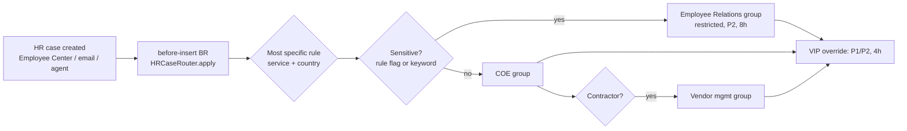

# ServiceNow HRSD Case Routing


> **Portfolio project.** This is independently written demonstration code that uses synthetic data. It is not taken from, and does not represent, any employer's or client's production code, and it is not a copy of ServiceNow out-of-box HRSD scripts.

Two configurable components for **HR Service Delivery**:

- **`HRCaseRouter`** routes HR cases to the right Center of Excellence and assignment group. It detects sensitive cases (harassment, medical, investigations, and similar) and restricts their visibility. It also sets priority and response targets, including contingent-worker and VIP handling.
- **`OnboardingPlanBuilder`** builds the onboarding lifecycle-event activity plan from a worker profile (country, employee type, remote or office, job family). Due dates are counted in business days, and the builder warns when lead time is too short.

## The business problem

HR shared-services teams lose time triaging cases that land in the wrong queue. Mis-routed sensitive cases are a compliance and privacy risk. Onboarding often misses steps, such as I-9 for U.S. hires or a home-office kit for remote workers, when the plan is not driven by worker attributes.



## Sample output (synthetic cases)

```
$ npm run demo
HR case routing
  c1 Payroll inquiry     -> hr_payroll_us          P4 16h
  c2 Payroll inquiry     -> hr_payroll_global      P4 24h
  c3 Benefits question   -> hr_employee_relations  P2  8h  [restricted]
  c4 Leave of absence    -> hr_employee_relations  P2  8h  [restricted]
  c5 Policy question     -> hr_vendor_mgmt         P4 24h
  c6 Employee relations  -> hr_employee_relations  P1  4h  [restricted]

Onboarding plan: US, remote, engineering, start 2026-12-07
  2026-11-26  home_office_kit        it_fulfillment
  2026-11-30  welcome_email          hr_tier1
  2026-11-30  laptop_request         it_fulfillment
  2026-12-02  payroll_setup          hr_payroll
  2026-12-04  dev_tool_access        it_access
  2026-12-10  i9_verification        hr_compliance
  2026-12-21  benefits_enrollment    hr_benefits
  2027-01-06  manager_30day_checkin  people_manager
```

## Tech stack

ServiceNow HRSD (HR cases, COEs, Lifecycle Events), Script Includes (ES5), before-insert Business Rules, Flow Designer, and system properties for JSON configuration. Tests use the Node.js 18+ built-in test runner (13 tests). GitHub Actions runs CI.

## Run locally

```bash
git clone https://github.com/pedapatisrujana-a11y/servicenow-hrsd-case-routing.git
cd servicenow-hrsd-case-routing
npm test
npm run demo
```

## Install in a ServiceNow instance (PDI with HRSD plugins)

1. Create the Script Includes from `src/`. Use the HR scope, or a custom scope with cross-scope access to the HR case table.
2. Create the system property `x_portfolio.hr.routing_rules` (type string) and paste the JSON from `config.example.json`.
3. Add custom fields if they don't already exist: `u_subject_country`, `u_employee_type`, `u_vip`, `u_coe`, and `u_sensitive`.
4. Create a **before-insert Business Rule** on the HR case table that runs `new HRCaseRouter().apply(current);`.
5. Enforce restricted visibility with ACLs or HR case restriction features for `u_sensitive = true`. The router sets the flag; ACLs do the enforcement.
6. For onboarding, call `OnboardingPlanBuilder.build()` from the lifecycle-event flow and create one HR task per activity.

## Privacy and security

- All sample data is fictitious. No PII is included.
- The router only sets routing fields. Access control for sensitive cases must be enforced with ACLs, never with client-side logic.
- Keyword detection uses word boundaries to reduce false positives. It is a triage aid, not a substitute for agent review.

## Limitations and next steps

- Keyword sensitivity is rule-based. Predictive Intelligence or Now Assist classification could improve it, and both are on the roadmap.
- Business-day math ignores regional holidays. A next step is to use `GlideSchedule` with the HR schedule in an instance.

## License

MIT. See [LICENSE](LICENSE).
